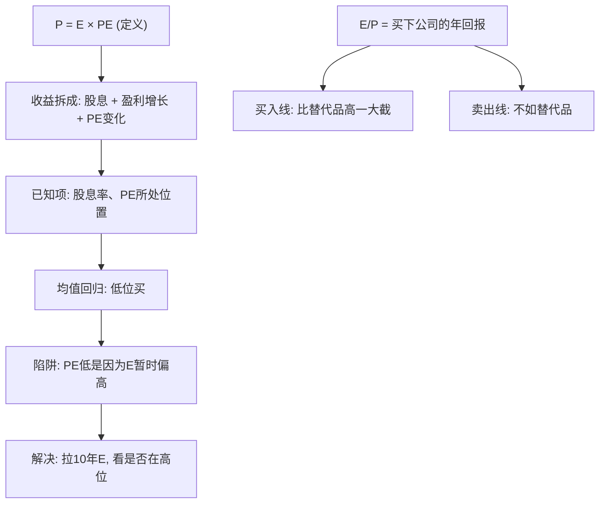

# 03 估值与选基：什么时候买，什么时候卖

> **对应原书**：第4章。回答：**这么多指数基金，现在哪些值得买？**
> 上一块：[[02-品种地图]]　下一块：[[04-定投买卖与计划]]（未读）
> **标记**：【原书】为作者观点；【核对】为我们用数据重算后的结果；原书数据均为2017年，未核验现状。

---

## 1. 起点：钱可以去哪，凭什么选指数

钱有两个大方向：

- **债券**：合同约定每年给利息，几乎稳定。
- **股票（指数）**：盈利不保证，价格可能腰斩，但长期能分享企业盈利。

选指数的唯一理由是：**它得比债券多给，而且多到值得你承担风险。**
所以后面所有阈值（10%、6.4%）都只是在回答一个问题：**多多少才够？**

这一块的主线：

---

## 2. 两个定义：所有推导的地基

**价格的构成（定义，不是经验）：**

$$
PE=\frac{P}{E}\;\Longrightarrow\;P=E\times PE
$$

价格 = 盈利 × 估值倍数。价格变化只有两个原因：**E 变了**，或**PE 变了**。两者是**相乘**，不能直接加减：

$$
E\text{ 涨 }20\%,\;PE\text{ 跌 }20\%\;\Rightarrow\;1.2\times0.8=0.96\;\text{（跌 4\%）}
$$

**盈利收益率（定义）：**

$$
盈利收益率=\frac{E}{P}=\frac{1}{PE}
$$

含义：把整个公司买下来，它**一年的盈利**占你出资的比例。PE=8 ⟺ 盈利收益率 12.5%。收益率越高，每投入 1 元买到的盈利越多，越便宜。

---

## 3. 四个估值指标（原书第4章）

| 指标 | 公式 | 适用前提 | 失效场景 |
|---|---|---|---|
| 市盈率 PE | $P/E$ | 流通性好、**盈利稳定** | 周期行业、成长期、亏损股（盈利E失真） |
| 盈利收益率 | $E/P$ | 同上 | 同上 |
| 市净率 PB | $P/B$ | 净资产稳定、有形资产为主 | 无形资产为主（律所、互联网）、长期亏损（净资产被侵蚀） |
| 股息率 | 现金分红$/P$ | 有稳定分红 | 盈利不稳定时分红不稳定 |

股息率与盈利收益率的关系：

$$
股息率=盈利收益率\times分红率
$$

分红率（分红÷净利润）长期基本不变，所以盈利收益率高时，股息率也高。

**价值投资三原则（格雷厄姆）：**

1. **价格与价值的关系**：价格围绕价值波动（小狗与主人），长期趋于一致。
2. **能力圈**：只买自己能判断价值的品种。
3. **安全边际**：价格大幅低于价值才买（"用0.4元买价值1元的东西"）。

**怎么查指数估值：** ①作者公众号 ②中证指数官网、恒生指数官网 ③付费终端（Wind、Choice）。只有指数基金能算估值，因为成份股公开；主动基金持仓不透明。

---

## 4. 买点：比债券多多少才够

**盈利收益率回答"一切不变时的年回报"。** 它能直接和债券利息比较。

债券有合同保证，指数没有，所以不能只高一点，要**高出一大截**作为风险补偿。格雷厄姆的两条：

1. 盈利收益率 $>10\%$。
2. 盈利收益率 $>$ 无风险利率的 2 倍。

2017年10年期国债约 3.5%，2倍是 7%，7% < 10%，所以实际约束是 10%。

> **【核对】** 10% 不是常数，是"两个条件里更严的那个"，即 $\max(10\%,\;2\times\text{无风险利率})$。若无风险利率涨到 6%，买入线应升到 12%。原书说"两条合二为一成10%"，只在2017年利率下成立；"取更严者"是我们的解读，原文没有这样写。

## 5. 卖点：不如替代品就走

卖出线跟买入线规则不同：**当指数的盈利收益率已经不如替代品，就没理由继续承担波动。** 原书用债券基金长期平均收益 6.4% 作替代品。

三个区间是同一个比较的三个位置：

| 盈利收益率 | 含义 | 操作（原书） |
|---|---|---|
| $>10\%$ | 比替代品高出一大截 | 分批投资 |
| $6.4\%\sim10\%$ | 比债基高，但补偿不够厚 | 坚定持有已买入的份额 |
| $<6.4\%$ | 不如债基 | 分批卖出（如分10份） |

> **【核对】** 卖出线跟着替代品走：若债基长期收益降到 3%，卖出线随之降到约 3%，而买入线仍是 $\max(10\%,\,2\times\text{无风险利率})$，不会跟着掉。

**港股指数的折扣：** 内地投资者买恒生、H股指数基金，有港股通分红税和换汇费用，所以盈利收益率要**打9折**再对照阈值。例：$11\%\times0.9=9.9\%<10\%$，不开始定投，已有份额继续持有。

**适用品种（原书）：** 上证红利、中证红利、上证50、基本面50、上证50AH优选、央视50、恒生指数、恒生国企指数。要求流通性好、盈利稳定。

---

## 6. 为什么盈利收益率高，未来回报就高：钱从哪来

**你持有指数一年，钱只有两个口袋：**

1. 公司把钱分给你（**股息**）。
2. 你手里的份额变值钱了。价格 $P=E\times PE$，只能因为 **E 变**或 **PE 变**而变。

没有第三个口袋。这是**拆账**，不是预测，所以这条公式永远成立：

$$
年回报\approx初始股息率+盈利增长+PE变化
$$

**精确写法（相乘）：**

$$
年回报=(1+g)(1+\Delta)-1+初始股息率
$$

其中 $g$ 是盈利年增长率，$\Delta$ 是 PE 年变化率。加法版只是把交叉项 $g\Delta$ 扔掉了。$|g|$、$|\Delta|$ 都在 10% 以内时可口算；高增长或估值剧变时必须用精确版。

### 三项里，哪些是现在就知道的

| 项 | 能否预知 | 说明 |
|---|---|---|
| 初始股息率 | **已知** | 买入那天就确定 |
| PE 的变化 | **未知，但有规律** | 均值回归：PE 在历史区间里周期波动。买在低位，下一步更可能上升；买在高位，更可能回落（概率，不是保证） |
| 盈利增长 | **未知** | 只能指望经济长期发展 |

### 投资思路

**在已知的两项上占便宜（股息率高、PE 在低位），把盈利增长当作额外的礼物。**

盈利收益率法正是它的快速版：$E/P$ 高 ⟺ PE 低，同时股息率 $=E/P\times分红率$ 也高，一次满足两个已知项。

---

## 7. 陷阱：PE 低，是价格低，还是盈利暂时偏高？

$$
PE=\frac{P}{E}
$$

PE 低有两种来源：**P 被压低**（真便宜），或 **E 暂时偏高**（假便宜）。

**典型：** 牛市里证券行业利润暴涨数倍，PE 从 40~60 掉到个位数。看着低，景气一过 E 骤减，PE 又回到几十倍。这就是**市盈率陷阱**。

代入 $P=E\times PE$：E 回落、PE 回升，两者相乘可以抵消，价格不动。所以"PE 在低位，未来 PE 会涨"只在 **E 没有同步回落**时才带来收益。

**怎么分辨：拉 10 年的 E，对比今年的 E 是否处在高位。**

- 今年 E 是近10年里最高、比平均水平高出一大截 → PE 低很可能是 E 高造成的，是陷阱。
- 今年 E 接近或低于长期平均 → PE 低更可能是价格真的便宜。

---

## 8. 盈利不稳定时怎么办：改看市净率

盈利不稳定或周期性变化的指数（证券、钢铁、航空、航运、能源），PE 和盈利收益率失效，但净资产相对稳定，可以用 PB。

博格公式的变种（不再含股息率，因为盈利不稳定时分红也不稳定）：

$$
年回报\approx PB\text{ 年变化率}+净资产\text{ 年增长率}
$$

前提：公司在最差时也不亏损，净资产才有保障。长期亏损的指数**直接放弃**，因为亏损会侵蚀净资产，PB 也失效。

**例（原书）：** 2004~2005年证券行业 PE 被动拉到 264 倍，看着很贵；但 PB 处于低位，随后的牛市收益很高。标普500在2008~2009年金融危机时 PE 冲到约100倍失效，PB 却显示已到底部。

## 9. 四类指数对应的方法

| 盈利状态 | 类型 | 方法 | 难度 |
|---|---|---|---|
| 稳定 | 价值指数 | 盈利收益率法（博格公式快速版） | 最简单，适合新手 |
| 高速增长 | 成长指数 | 博格公式，看 PE 在**自己的历史区间**的位置 | 需分析历史数据 |
| 不稳定/周期，但不长期亏损 | 周期指数 | 博格公式变种，看 PB 在历史区间的位置 | 更难 |
| 长期亏损 | 困境指数 | 放弃 | — |

成长指数不能套固定的 10% 线：E 在快速变化，用静态 $1/PE$ 会误判。

---

## 10. 数据部分：原书说法与我们的核对

**（1）沪深300案例（博格公式）**

- **原书说法：** 10年间沪深300（含分红）上涨约3倍，年复合 11.7%。初始股息率 1.86%，PE 从 19.71 降到 13.17（年变化约 −4%），盈利"增长了383%"（年均 14.4%）。三项相加得 12.26%，扣除佣金、分红税、管理费后约 11.7%。
- **我们核对的：**
  - "增长了383%"字面是变为 4.83 倍，对应年化 17.1%；书里 14.4% 实际对应 3.83 倍（$3.83^{1/10}-1\approx14.4\%$），措辞不严。
  - 精确复合：$3.83^{1/10}\times(13.17/19.71)^{1/10}-1\approx9.85\%$，加股息率 1.86% 得 **11.71%**，正好是书里的 11.7%。
  - 所以 11.7% 更像精确复合的直接结果，与 12.26% 的差主要是交叉项 $g\Delta$，书里"扣费"的解释无法证实。

**（2）盈利收益率法回测**

- **原书说法：** 2004~2015年，上证50指数基金年复合 29.27%，红利 29.9%；无脑定投分别 12.3%、13.07%。恒生指数5次盈利收益率>10%的阶段，平均年复合 20% 以上。
- **我们核对的：** 样本是十来年、一次牛市，且作者说"未来大概率15%~20%"是预测，不是结论。恒生各次区间的收益由起止点推算，对起止时点很敏感。

**（3）西格尔股息研究**

- **原书说法：** 标普500，1871~2012年，实际收益率 6.48%，其中股息分红 4.4%，资本利得 1.99%。
- **我们核对的：** 4.4%+1.99%=6.39%，与 6.48% 差 0.09 个点，书里未说明（可能是四舍五入或再投资效应），未核验原始出处。

---

## 11. 尚未核验

- 阈值（10%、6.4%、3.5%、9折）均为2017年数据，现行利率环境下是否合适未核验。
- 均值回归是经验规律，不是定律；原书未给反例或失效条件。
- 原书"年复合收益率"与实际可得收益之间的费用差，没有给出具体数字。

---

## 12. 自测题

先用自己的话回答，再看检查要点。

1. 一个指数一年内从3000点涨到4500点，成份股总盈利几乎没变。用 $P=E\times PE$ 解释发生了什么，这对买入有什么提示？
2. 为什么买入线不是固定的10%？利率涨到6%，买入线怎么变？卖出线又跟着什么变？
3. 两个指数盈利收益率都是10%，分红率分别是20%和60%。股息率各是多少？分红率低的一方，多出来的钱去了哪里？
4. 博格公式的三项里，哪两项是买入时已知的？投资思路为什么是"在已知项占便宜，把未知项当礼物"？
5. 钢铁指数 PE 从30降到6，有人说"才6倍，该买"。哪里有问题？你怎么核对？

### 检查要点

**1．** $E$ 不变、$P$ 涨50%，所以 $PE$ 也涨约50%，涨幅全来自估值抬升，不是公司更赚钱。提示：价格涨不代表价值涨，追高时买到的是别人更乐观的情绪。

**2．** 买入线 $=\max(10\%,\;2\times\text{无风险利率})$，利率6%时升到12%。卖出线跟替代品（债基）的收益走，与无风险利率的2倍无关。

**3．** 股息率 $=$ 盈利收益率 $\times$ 分红率：分别是 2% 和 6%。分红率低的一方把更多盈利留在公司里，若能赚出回报，会转化为未来盈利增长，但不保证总回报更高。

**4．** 初始股息率（买入那天确定）和 PE 所处的历史位置（可查）。盈利增长无法预知。把确定的部分买便宜，剩下的不确定项就算不如预期，亏的概率也更小。

**5．** PE 低可能是 E 暂时偏高（周期顶），E 回落后 PE 会回升，价格不动甚至下跌。核对：拉10年的 E，看今年是不是历史高位；周期行业改看 PB，前提是不会长期亏损。
